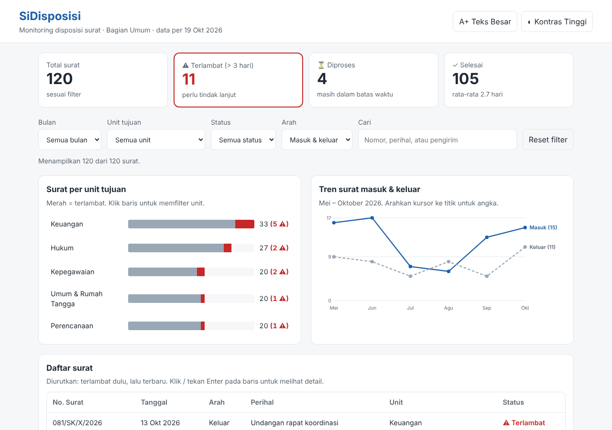
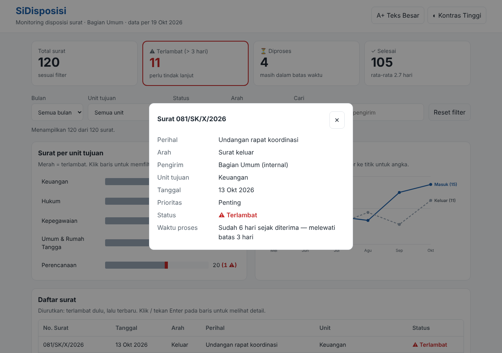
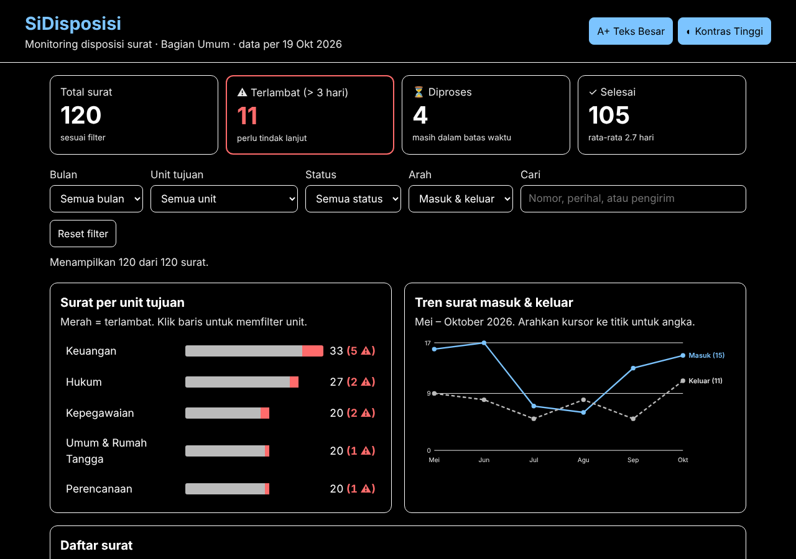

<div align="center">

# 📨 SiDisposisi

### Dasbor Monitoring Disposisi Surat Berbasis *User-Centered Design*

Studi kasus penerapan materi **Human-Computer Interaction & Data Visualization**
(Pemateri: Arafat Febriandirza — BRIN, 19 Oktober 2026)




</div>

---

## 📑 Daftar Isi

1. [Latar Belakang](#-latar-belakang)
2. [Deskripsi Studi Kasus](#-deskripsi-studi-kasus)
3. [Rumusan Masalah](#-rumusan-masalah)
4. [Tujuan](#-tujuan)
5. [Batasan Masalah](#-batasan-masalah)
6. [Persona Pengguna](#-persona-pengguna)
7. [Proses Desain (UCD)](#-proses-desain-ucd)
8. [Pemetaan Materi → Implementasi](#-pemetaan-materi--implementasi)
9. [Fitur Aplikasi](#-fitur-aplikasi)
10. [Struktur Proyek](#-struktur-proyek)
11. [Cara Menjalankan](#-cara-menjalankan)
12. [Cara Upload ke GitHub](#-cara-upload-ke-github)
13. [Rencana Uji Usability](#-rencana-uji-usability)
14. [Pengembangan Lanjutan](#-pengembangan-lanjutan)
15. [Referensi](#-referensi)
16. [Identitas Mahasiswa](#-identitas-mahasiswa)

---

## 🧭 Latar Belakang

Di banyak kantor, surat masuk dan keluar dicatat dalam **buku agenda atau spreadsheet** berisi ratusan baris. Untuk menjawab pertanyaan sederhana seperti *"surat mana yang belum ditindaklanjuti?"*, pimpinan harus membaca baris satu per satu. Menurut materi, kondisi ini menimbulkan **beban kognitif** yang tinggi karena *working memory* manusia hanya mampu menampung sekitar **7 ± 2 item** sekaligus.

Materi IMK dan visualisasi data menekankan bahwa antarmuka yang baik adalah antarmuka yang **mengurangi beban pikiran penggunanya**, bukan yang paling cantik. Proyek ini menerjemahkan prinsip tersebut ke dalam sebuah dasbor sederhana untuk administrasi perkantoran.

## 🏢 Deskripsi Studi Kasus

**Bagian Umum** pada sebuah kantor pemerintah daerah (**fiktif**) mengelola rata-rata 20 surat per bulan yang didisposisikan ke 5 unit kerja: Keuangan, Kepegawaian, Umum & Rumah Tangga, Perencanaan, dan Hukum.

Kantor menetapkan aturan (SLA) bahwa **setiap disposisi wajib selesai paling lama 3 hari**. Masalahnya:

- Pencatatan masih berupa tabel panjang, sehingga surat yang **melewati batas waktu tidak terlihat**.
- Kepala Bagian (usia 50-an) kesulitan membaca tabel kecil di layar.
- Staf administrasi harus **menghafal** nomor surat saat berpindah antara tabel rekap dan arsip detail.

**Solusi:** **SiDisposisi**, dasbor satu halaman yang menampilkan ringkasan status, grafik per unit dan tren bulanan, filter, serta detail surat yang muncul hanya ketika dibutuhkan.

## ❓ Rumusan Masalah

1. Bagaimana merancang dasbor yang membuat pengguna dapat mengenali surat **terlambat** dalam hitungan detik?
2. Bagaimana menerapkan mantra Shneiderman *"Overview first, zoom and filter, then details-on-demand"* pada data disposisi surat?
3. Bagaimana membuat antarmuka yang **inklusif** bagi pengguna lansia sekaligus efisien bagi staf muda?
4. Bagaimana menyajikan grafik yang informatif tanpa *chartjunk*?

## 🎯 Tujuan

1. Menghasilkan prototipe dasbor *high-fidelity* yang berjalan di browser.
2. Menunjukkan penerapan konsep kognitif (*working memory*, *extraneous load*, *preattentive attributes*) secara nyata dalam kode.
3. Menerapkan prinsip aksesibilitas WCAG dan menghindari *dark patterns*.
4. Menyediakan dokumentasi yang bisa dipakai sebagai bahan laporan tugas.

## 🚧 Batasan Masalah

| No | Batasan | Keterangan |
|---|---|---|
| 1 | **Data fiktif** | 120 surat dummy (Mei–Oktober 2026) dibangkitkan dengan *seeded random* di `data.js`. Tidak mewakili instansi nyata. |
| 2 | **Hanya sisi front-end** | Tidak ada server, database, maupun login. Data hanya dibaca (*read-only*), tidak bisa ditambah atau diubah. |
| 3 | **Fokus pada monitoring** | Aplikasi tidak menangani pembuatan surat, tanda tangan elektronik, atau alur persetujuan. |
| 4 | **SLA disederhanakan** | Batas 3 hari dihitung sebagai **hari kalender**, bukan hari kerja. Tanggal acuan tetap: 19 Oktober 2026. |
| 5 | **Status 3 kategori** | Selesai, Diproses (≤ 3 hari), dan Terlambat (> 3 hari, belum selesai). |
| 6 | **Pengguna sasaran** | Kepala Bagian Umum dan staf administrasi. Tidak dirancang untuk publik/pengirim surat. |
| 7 | **Persona hipotetis** | Persona disusun dari gambaran umum pegawai kantor, belum dari riset lapangan sungguhan. |
| 8 | **Uji usability berupa rencana** | Skenario pengujian disediakan (lihat bawah), namun belum dilaksanakan dengan responden. |
| 9 | **Teknologi** | HTML, CSS, dan JavaScript murni tanpa library, agar ringan dan bisa dibuka *offline*. |

## 👥 Persona Pengguna

<table>
<tr>
<td width="50%" valign="top">

### 👨‍💼 Pak Hendra, 54 tahun
**Kepala Bagian Umum**

- Memakai laptop kantor, jarang menggunakan aplikasi baru.
- Mata mulai *plus*, sulit membaca teks kecil.
- **Kebutuhan:** tahu dalam sekali lihat berapa surat yang terlambat dan di unit mana.
- **Frustrasi:** *"Saya harus scroll tabel panjang hanya untuk tahu siapa yang lambat."*
- **Desain untuknya:** kartu KPI besar, tombol **A+ Teks Besar**, **Kontras Tinggi**, tombol berukuran ≥ 44px.

</td>
<td width="50%" valign="top">

### 👩‍💻 Rina, 26 tahun
**Staf Administrasi Persuratan**

- Terbiasa dengan keyboard dan pencarian cepat.
- Setiap hari menelusuri nomor surat tertentu.
- **Kebutuhan:** mencari surat secepat mungkin dan melihat detailnya.
- **Frustrasi:** *"Saya harus mencatat nomor surat dulu, lalu buka file lain untuk lihat detailnya."*
- **Desain untuknya:** kolom pencarian instan, filter kombinasi, navigasi **Tab + Enter**, detail dalam dialog tanpa pindah halaman.

</td>
</tr>
</table>

## 🔁 Proses Desain (UCD)

Mengikuti prinsip **"pengguna bukanlah Anda"** dan siklus iteratif:

```
 ┌──────────────┐    ┌──────────────┐    ┌──────────────┐    ┌──────────────┐
 │ 1. Pahami    │ →  │ 2. Tentukan  │ →  │ 3. Rancang   │ →  │ 4. Evaluasi  │
 │   konteks    │    │  kebutuhan   │    │  (lo-fi →    │    │  dengan      │
 │  & persona   │    │  pengguna    │    │   hi-fi)     │    │  pengguna    │
 └──────────────┘    └──────────────┘    └──────────────┘    └──────┬───────┘
        ▲                                                           │
        └───────────────────── iterasi ulang ◄──────────────────────┘
```

### Sketsa Low-Fidelity (*Fail early, fail cheap*)

Sebelum coding, tata letak disketsa terlebih dahulu. Versi digitalnya:

```
┌───────────────────────────────────────────────────────────┐
│ SiDisposisi                         [A+ Teks] [◐ Kontras] │
├───────────────────────────────────────────────────────────┤
│ [ Total ]  [ ⚠ TERLAMBAT ]  [ Diproses ]  [ Selesai ]     │ ← OVERVIEW
├───────────────────────────────────────────────────────────┤
│ Bulan▾  Unit▾  Status▾  Arah▾  [ Cari........ ] [Reset]   │ ← ZOOM & FILTER
├────────────────────────────┬──────────────────────────────┤
│ Surat per unit (bar)       │ Tren bulanan (line)          │
│ Keuangan ██████▓▓ 33 (5⚠)  │   ╱╲      ╱‾‾ Masuk          │
│ Hukum    █████▓   27 (2⚠)  │  ╱  ╲__╱‾‾   Keluar          │
├────────────────────────────┴──────────────────────────────┤
│ No. Surat │ Tanggal │ Perihal │ Unit │ Status             │ ← klik baris
│ 081/SK/X  │ 13 Okt  │ ...     │ Keu  │ ⚠ Terlambat        │   ↓
└───────────────────────────────────────────────────────────┘  DETAIL (dialog)
```

**Temuan dari sketsa awal yang langsung direvisi:**
- Versi pertama memakai diagram lingkaran (pie) untuk 5 unit → sulit membandingkan sudut, **diganti grafik batang**.
- Legenda grafik garis terpisah memaksa mata bolak-balik → **label ditaruh langsung di ujung garis**.
- Detail surat awalnya di halaman lain → memaksa pengguna menghafal nomor surat → **diganti dialog di halaman yang sama**.

## 🧠 Pemetaan Materi → Implementasi

| Konsep dari Materi | Penerapan di SiDisposisi | Lokasi Kode |
|---|---|---|
| **User-Centered Design** | Fitur diturunkan dari kebutuhan 2 persona | README, seluruh UI |
| **Working memory 7±2** | Hanya **4 KPI**, 5 unit, 3 status; detail muncul di halaman yang sama sehingga pengguna tidak perlu menghafal nomor surat | `renderKPI()`, `bukaDetail()` |
| **Mengurangi Extraneous Load** | Tata letak satu kolom bacaan atas → bawah; warna netral; surat terlambat **otomatis diurutkan paling atas** | `renderTabel()`, `style.css` |
| **Preattentive Visual Attributes** | Hanya kategori **Terlambat** yang berwarna merah (KPI berbingkai merah, segmen merah di grafik). Mata menangkapnya < 200 ms | `.alarm`, `.seg.telat` |
| **Variasi pengguna** | Lansia → Teks Besar & Kontras Tinggi. Profesional muda → pencarian instan, keyboard (Tab/Enter/Esc) | `setPref()`, event `keydown` |
| **WCAG** | Status = warna **+ ikon + teks** (1.4.1), fokus terlihat (2.4.7), *skip link* (2.4.1), target ≥ 44px (2.5.8), `aria-live` jumlah hasil, `aria-label` pada grafik | `index.html`, `style.css` |
| **Etika, tanpa dark patterns** | Tidak ada pop-up paksa, tidak ada tombol menyesatkan; tombol **Reset filter** selalu tersedia; preferensi bisa dimatikan lagi | `#btnReset` |
| **Persona** | Pak Hendra & Rina | Bagian Persona |
| **Prototipe low-fidelity** | Sketsa ASCII + catatan revisi | Bagian Proses Desain |
| **Pemilihan jenis grafik** | **Batang** untuk membandingkan kategori (unit), **garis** untuk tren waktu (bulan) | `renderBar()`, `renderLine()` |
| **Tanpa Chartjunk (Tufte)** | Tanpa 3D, bayangan, atau gradasi; gridline hanya 3; label langsung pada data | `renderLine()`, `style.css` |
| **Mantra Shneiderman** | **Overview** = KPI + grafik → **Zoom & filter** = 5 filter + klik batang unit → **Details-on-demand** = klik baris | `app.js` (komentar header) |

## ✨ Fitur Aplikasi

| Fitur | Deskripsi |
|---|---|
| 📊 **Kartu ringkasan** | Total, Terlambat, Diproses, Selesai (+ rata-rata lama penyelesaian) |
| 🔎 **Filter kombinasi** | Bulan, unit, status, arah surat, dan pencarian teks |
| 📶 **Grafik batang interaktif** | Klik batang unit untuk langsung memfilter; klik lagi untuk membatalkan |
| 📈 **Grafik tren** | Surat masuk vs keluar per bulan; bulan yang difilter disorot |
| 📋 **Tabel prioritas** | Surat terlambat selalu di atas |
| 🪟 **Detail on-demand** | Dialog detail lengkap, termasuk berapa hari sudah lewat batas |
| ♿ **Aksesibilitas** | Teks besar, kontras tinggi, navigasi keyboard, pembaca layar |
| 💾 **Ingat preferensi** | Pilihan tampilan disimpan di browser (*localStorage*) |

<details>
<summary><b>📸 Lihat tangkapan layar lainnya</b></summary>

**Detail surat (details-on-demand)**


**Mode Teks Besar + Kontras Tinggi**


</details>

## 📁 Struktur Proyek

```
sidisposisi/
├── index.html      # Struktur halaman (semantic HTML + ARIA)
├── style.css       # Tampilan, tema kontras tinggi, responsif
├── data.js         # Data dummy 120 surat (seeded random)
├── app.js          # Logika filter, grafik, tabel, dialog
├── docs/           # Tangkapan layar untuk README
├── LICENSE
└── README.md
```

## ▶️ Cara Menjalankan

Tidak perlu instalasi apa pun.

1. Ekstrak file zip.
2. Buka folder `sidisposisi`.
3. Klik dua kali **`index.html`** → otomatis terbuka di browser (Chrome, Edge, atau Firefox).

> 💡 Coba: klik batang **Keuangan**, pilih status **Terlambat**, lalu klik salah satu baris tabel.

## 🚀 Cara Upload ke GitHub

### Cara A — Lewat website (tanpa coding)

1. Login ke [github.com](https://github.com) → klik **New repository**.
2. Isi nama: `sidisposisi`, pilih **Public**, **jangan** centang *Add a README* → **Create repository**.
3. Klik **uploading an existing file**.
4. Seret **semua isi** folder `sidisposisi` (termasuk folder `docs`) ke halaman tersebut.
5. Tulis pesan commit, misalnya `Upload studi kasus SiDisposisi` → **Commit changes**.

### Cara B — Lewat Git (terminal)

```bash
cd sidisposisi
git init
git add .
git commit -m "Studi kasus IMK: dasbor SiDisposisi"
git branch -M main
git remote add origin https://github.com/keniafeblia/Session-05-IMK.git
git push -u origin main
```

> Repositori GitHub: `https://github.com/keniafeblia/Session-05-IMK.git`

### 🌐 Bonus: Jadikan website online (GitHub Pages)

1. Buka repository → **Settings** → **Pages**.
2. Pada *Source*, pilih **Deploy from a branch** → branch **main** → folder **/ (root)** → **Save**.
3. Tunggu 1–2 menit. Dasbor bisa diakses di `https://keniafeblia.github.io/Session-05-IMK/`.

## 🧪 Rencana Uji Usability

Sesuai prinsip UCD, prototipe perlu diuji langsung ke pengguna. Skenario yang disiapkan:

| No | Tugas untuk Responden | Konsep yang Diuji | Indikator Berhasil |
|---|---|---|---|
| T1 | "Berapa surat yang terlambat saat ini?" | Overview, preattentive | Dijawab < 5 detik |
| T2 | "Unit mana yang paling banyak surat terlambat?" | Grafik batang | Dijawab < 10 detik tanpa melihat tabel |
| T3 | "Tampilkan hanya surat masuk bulan Agustus untuk unit Hukum." | Zoom & filter | Selesai tanpa bantuan |
| T4 | "Cari surat perihal peminjaman aula, lalu lihat siapa pengirimnya." | Details-on-demand | Selesai < 30 detik |
| T5 | (Responden lansia) "Perbesar tampilan agar nyaman dibaca." | Aksesibilitas | Menemukan tombol tanpa petunjuk |

**Metrik:** tingkat keberhasilan tugas, waktu penyelesaian, jumlah kesalahan, dan kuesioner **SUS (System Usability Scale)**. Target skor SUS ≥ 68 (di atas rata-rata).

## 🔮 Pengembangan Lanjutan

- Menghubungkan ke database atau Google Sheets agar data bisa diperbarui.
- Formulir input surat dan perubahan status disposisi.
- Perhitungan SLA berdasarkan **hari kerja** (tanpa akhir pekan dan libur nasional).
- Notifikasi pengingat untuk unit yang memiliki surat hampir terlambat.
- Melakukan uji usability sungguhan lalu merevisi desain (iterasi berikutnya).

## 📚 Referensi

1. Febriandirza, A. (2026). *Human-Computer Interaction & Data Visualization* [Materi sesi]. BRIN.
2. Miller, G. A. (1956). The magical number seven, plus or minus two. *Psychological Review, 63*(2), 81–97.
3. Sweller, J. (1988). Cognitive load during problem solving. *Cognitive Science, 12*(2), 257–285.
4. Shneiderman, B. (1996). The eyes have it: A task by data type taxonomy for information visualizations. *IEEE Symposium on Visual Languages*.
5. Tufte, E. R. (1983). *The Visual Display of Quantitative Information*. Graphics Press.
6. Norman, D. A. (2013). *The Design of Everyday Things* (Revised ed.). Basic Books.
7. W3C. (2023). *Web Content Accessibility Guidelines (WCAG) 2.2*. https://www.w3.org/TR/WCAG22/
8. Brooke, J. (1996). SUS: A "quick and dirty" usability scale. *Usability Evaluation in Industry*.

---

## 👤 Identitas Mahasiswa

| Informasi | Keterangan |
|---|---|
| **Nama Lengkap** | **Kenia Nurma Feblia** |
| **NPM** | **G1A023004** |
| **Program Studi** | Informatika |
| **Universitas** | Universitas Bengkulu |
| **Mata Kuliah / Sesi** | IMK & Visualisasi Data (Sesi 5) |
| **Repository GitHub** | [Session-05-IMK](https://github.com/keniafeblia/Session-05-IMK) |

---

<div align="center">

**Disusun Oleh:**  
### **Kenia Nurma Feblia**  
**NPM: G1A023004**  
**Program Studi Informatika — Universitas Bengkulu**

<br/>

Dibuat sebagai tugas studi kasus mata kuliah/sesi **IMK & Visualisasi Data**  
Seluruh data dalam proyek ini **fiktif** dan hanya untuk keperluan pembelajaran.

</div>
